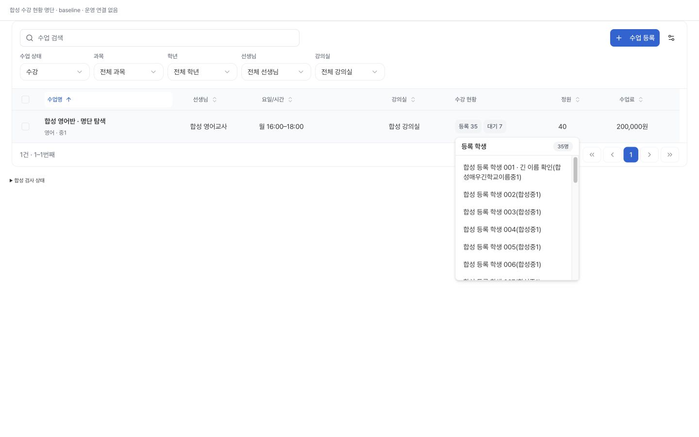
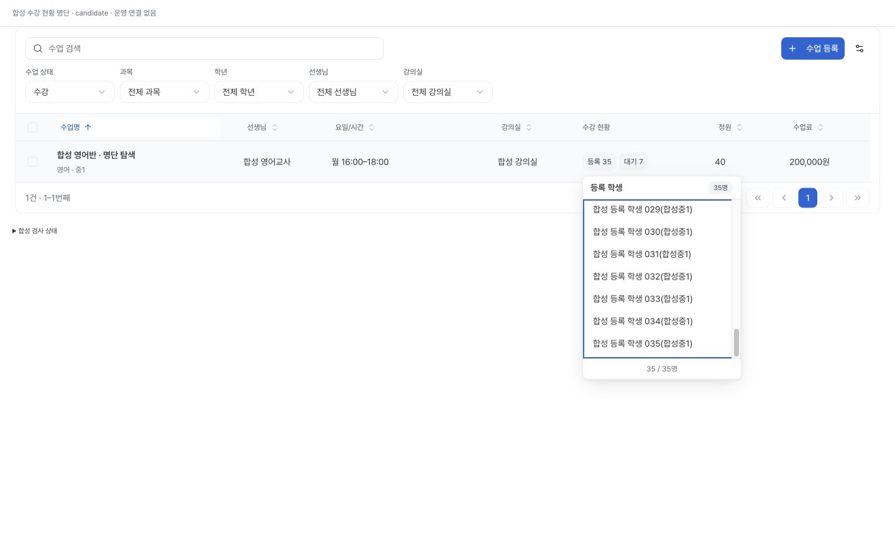
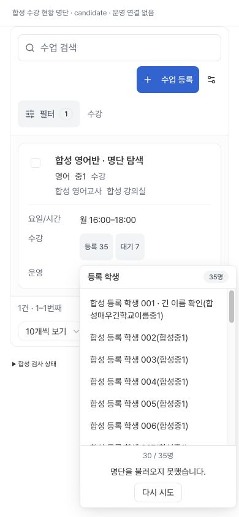
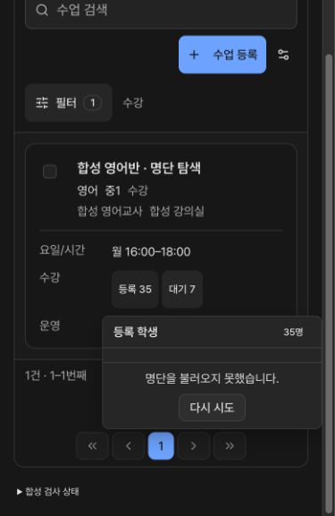

# 수업 목록 등록·대기 명단의 페이지 탐색

## 문제와 범위

기준 main `cf31e578e8c4ed29abac6e934233fe66f625c19b`. 수업 목록의 등록/대기 인원 팝오버가 전체35명을 표시하면서 첫30명만 읽고 다음 페이지를 제공하지 않았다. 실제 서비스의 `hasMore`/`nextCursor`를 훅 어댑터가 버리는 결함이다. 수업 상세의 기존 명단 페이지 이동은 별개이며 수정하지 않았다. 운영에서31명 이상인 사례나 발생 빈도는 이번에 관측하지 않았다.

기존 `StudentEnrollmentStatusCell`, `EnrollmentStatusTrigger`, Popover, Button을 기준으로 현재 불러온 범위와 명시적인 추가 조회를 제공한다. 등록/대기별 행·커서·오류·진행 상태를 분리한다. 실패한 동일 커서를 재시도하고 기존 행을 유지한다. 같은 순간의 중복 요청과 수업/인원 변경 후 늦은 응답을 무효화한다. 0명은 읽지 않는다. 부분 임베디드 자료는 전체 명단으로 오인하지 않는다.

SQL/API/권한/쓰기/30명 요청 제한/새 의존성/저장 설정은 변경하지 않았다. 정상 읽기 응답의 cursor를 그대로 전달하고, 전체 명단 자동 조회나 민감 검색어 URL 기록을 추가하지 않는다. 같은 인원수에서 구성원만 교체되는 경우의 기존 캐시 정책까지 새로 검증하거나 개선했다고 주장하지 않는다.

## 실제 소스 격리 검증

- 실제 훅과 실제 조회 서비스에 메모리 RPC를 연결한 수정 전 재현에서 다음 페이지 정보 소실이 예상 실패로 확인됐다. 별도 실제 컴포넌트 재현도35명 중30명 뒤 더보기 부재에서 예상 실패했다.
- 직접 행동 회귀10개 통과: 기존 조회/정렬/재개방,30+5/중복제거,등록·대기 독립 상태,첫/추가 실패/null/잘못된 커서 재시도,중복 요청,수업/인원 변경 및 unmount 응답 무효,실제 훅과 서비스의 bounded cursor 전달. 직접10개는 아래927개에 포함한다.
- 관련 필수42개 파일 **927/927 통과**, skipped/cancelled0. TypeScript0, 전체 ESLint0(기존 warning15), production build0, diffcheck0. 소스·테스트 실행 전후 해시는 동일하다. 빌드는 환경 파일 없이 비밀을 전달하지 않고 외부 연결 차단 상태로 수행했다.
- 필수 원격 CI의 불변 영역은 사용자 승인 로컬 대체 절차의 동일 파일/증거 SHA로 검토한다. 최종 head query/immutable 및 정확한 독립 검토는 workspace 최종 인수 기록에 연결한다. 원격 CI success로 표현하지 않는다.

## 실제 Chrome 합성 화면

실제 ManagementPage/table/cell/Radix/CSS와 원문 AST로 추출한 해당 버전의 hook callback, 실제 read service를 사용했다. 목록·인증 수명은 합성 훅으로 대체하고 RPC만 메모리 응답으로 제공했다. 따라서 브라우저 검증은 전체 인증·RLS·DB 실행의 증거가 아니다. 모든 이름/학교/수업은 합성이다. `127.0.0.1:4190` GET/HEAD 정적 서버, CSP `connect-src 'none'; form-action 'none'`, 직접 네트워크·쓰기 guard를 사용했다. 신규 설치 없음.

| 상태 | 실제 확인 |
|---|---|
| baseline1440×900 | 헤더35명/본문30명/더보기없음 |
| candidate1440×900 |30/35명→Enter추가조회→35/35명,추가버튼제거,명단region초점유지,End로마지막35번째가보임 |
|390×844추가조회오류 |30명유지,오류/다시시도화면안노출,같은cursor재시도→35명/오류제거 |
|390×600다크첫오류 |빈성공과구분한오류·재시도노출,재시도→30명/명단초점 |
|0명 |등록학생없음,합성RPC0회 |
|조회중모드전환 |등록응답보다대기가먼저완료해도대기7명유지,늦은등록응답혼합없음;등록재개방30명캐시/read2회그대로 |
|키보드/정리 |Escape후인원trigger초점복귀,합성탭닫기,viewportoverride해제.기존운영대시보드유지 |

JSDOM 모드전환 프로브에서 popup닫힘이 관측됐으나 실제 Chrome에서는 대기 명단이 열린 채 유지됐다. 두 결과를 구분한다. 확인한 브라우저 상태의 blocked/runtimeErrors는0이며 성능 개선 수치를 측정하지 않았다. 물리 모바일·소프트웨어 키보드·전체 WCAG 완료 주장은 하지 않는다.

## 인수와 롤백 기준

운영 데이터 읽기/저장 검증과 격리 합성 검증은 별개다. 게시·정상 병합·Ready Production의 실제 source 및 해당 비저장 UI를 확인하기 전에는 완료 집계를12/100에서 올리지 않는다. 이번 후보 게시 승인을 PR172 승인에서 자동 승계하지 않는다. 이전 검증 main은cf31e578, Production은`AdeZbMCqixWKeb1TxGueEyDCyYNp`이다. SQL변경이 없어 DB복구 계획은 필요하지 않다.

작업공간 `class-roster-preview-20261025/`의 plan-and-status, baseline-component/producer-result, direct-test-result, tests-results, static-results, build-result, required-tests, local-reuse-audit, browser-results 및 독립 검토 기록이 상세 증거다. 이 문서는 커밋 시점의 근거이며 이후 배포/운영 결과는 최종release-status와 PR에 남긴다.
