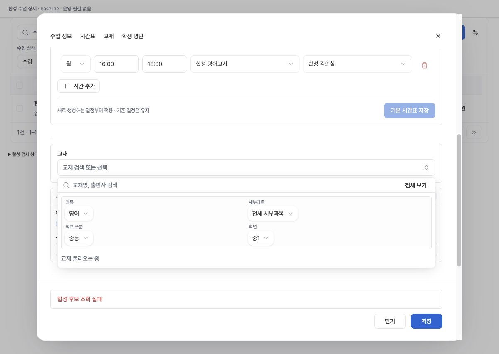
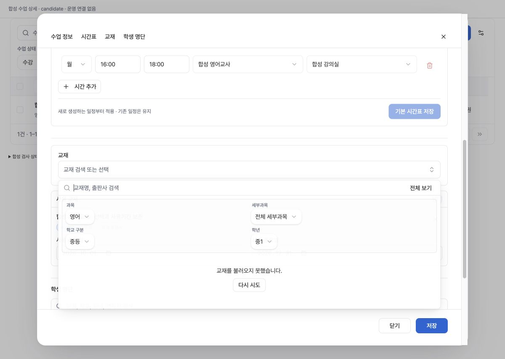
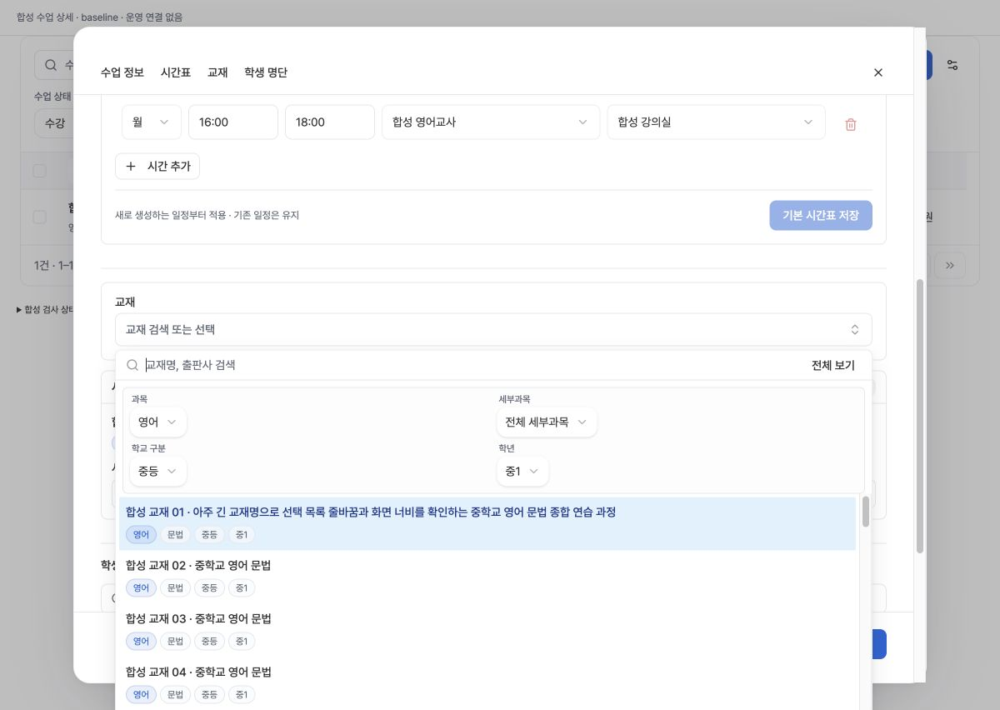
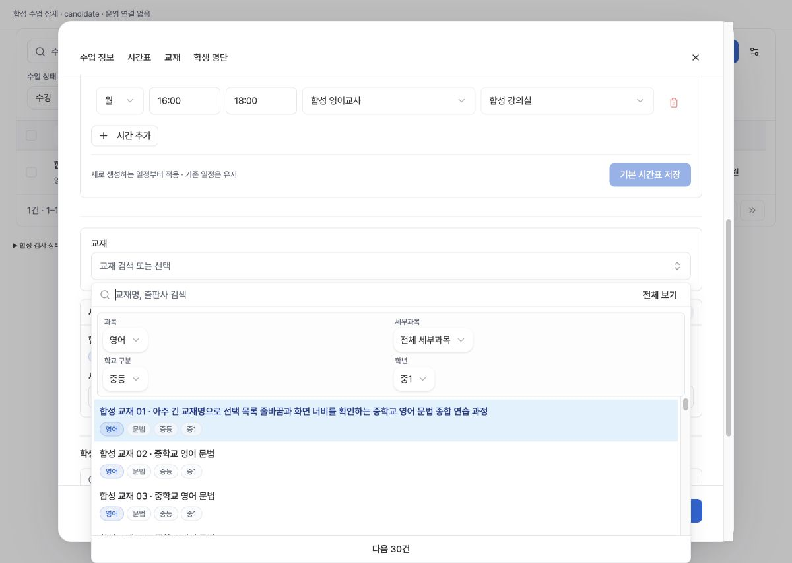
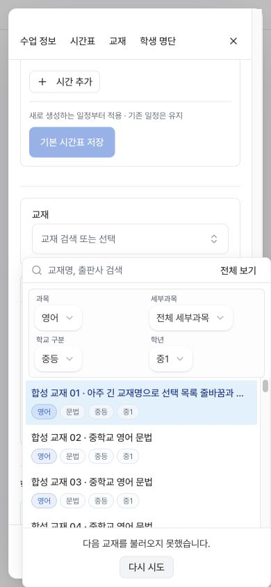
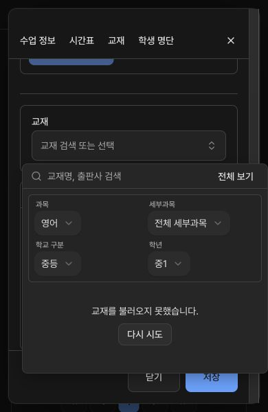
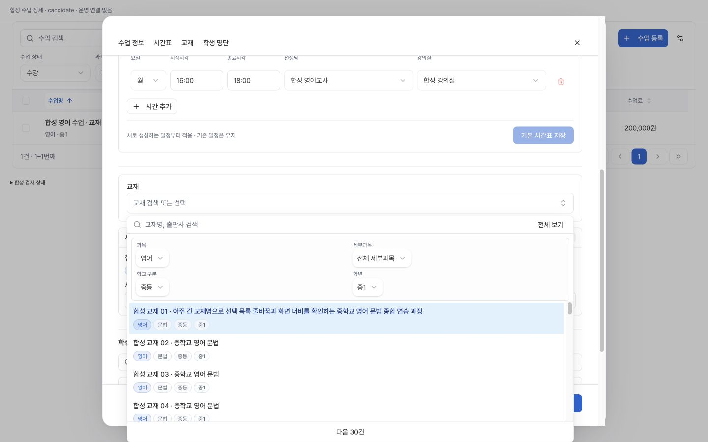

# 수업 상세 교재 선택 조회 복구 / 화면 내 배치

## 문제와 범위

수업관리 → 수업 상세 → 교재 선택의 첫 후보 조회가 실패하면 미확정 scope 때문에 계속 로딩으로 표시되고 같은 조건으로 재시도할 수 없었다. 정상 데이터에서도 선택창이 가용 높이를 넘겨 검색 또는 다음 페이지가 화면 밖으로 잘렸다.

기준 main `8683027b06b7f48c42b891e0aff3c00b43194949`. 기존 SearchCombobox/Button/semantic token과 수업 상세의 저장/초안 소유권을 유지한다. scope별 첫/추가 조회 오류를 선택창 안에 표시하고 같은 조건/커서로 다시 읽는다. 추가 실패는 기존 행·커서·선택·사용기간을 유지한다. 이전 scope 응답과 중복 재시도를 차단한다. 기존 wrapTrigger opt-in의 가용 높이 제한을 사용한다. 공유 컴포넌트 구현·SQL·API·권한·업무 쓰기·의존성은 바꾸지 않았다.

## 자동 검증

- 영향받는 필수 CI4/5/10/11 그룹과 직접 소비자: 중복제거38파일, 735/735 PASS, skip0/cancel0, Node22.18.0 cleanenv, exit0, 변경소스/테스트 해시 실행 전후 동일.
- 신규6개는 위735에 포함한다. first/null/more 실패·동일범위 재시도·stale 검색/수업/추가페이지 응답·중복제출 방지·선택과 사용기간 보존. 세 업무 writer 호출0.
- baseline의 같은 첫실패 테스트는 예상실패하여 원결함 재현. 실패한 baseline을 통과 검사로 세지 않는다.
- TypeScript/full ESLint exit0(기존15warning/0error), 프로덕션 build exit0. 빌드는 외부 연결 사전 차단 및 자격증명 없는 환경.
- 불변 필수 CI 범위는 승인된 로컬 대체에 따라 이전 성공 기록과 source/workflow/closure 해시를 독립 대조한다. GitHub billing으로 시작되지 않은 원격 job을 success로 바꾸지 않는다. 최종 commit/base/merge 연결 및 배포 확인은 release 기록에 별도 남긴다.

## 실제 Chrome 합성 검증

운영 데이터/토큰 없이 실제 ManagementPage·ClassTextbookPicker·Radix·CSS를 사용한다. 데이터hook/서비스경계만 합성이며 fetch/XHR/WebSocket/EventSource/beacon 차단. 로컬 GET/HEAD 서버는127.0.0.1:4190, CSP connect/form 차단. 실제화면과 JSDOM 결과를 구분한다.

| 조건 | 실제 결과 |
|---|---|
| 1200×852 baseline 첫실패 | 교재 불러오는 중 유지, retry없음, 오류가 먼 저장영역에 표시 |
| 같은 candidate 첫실패 | 선택창안 오류/다시시도. Enter → 같은범위30행, 검색초점유지 |
| 정상30행 baseline1200×852 | popup top419.5/bottom922.5로 다음페이지잘림 |
| 같은 candidate 정상30행 | popup top427.5/bottom852, 검색·목록·다음페이지가 화면안 |
| 390×844 more실패 | 기존30행 유지, retry버튼bottom831.5; 같은커서retry→35행 |
| 390×600 normal/darkerror | 정상popup top0/bottom301; darkerror top238/bottom544, retry471–503. 복구30행 |
| 1440×900 empty/normal | 성공0은 별도 빈결과; 정상30행 및 다음페이지bottom895.5; 수평넘침0 |
| 키보드 | retry Enter 후 검색초점유지; Escape animation완료후 opener복귀/popover0 |

합성연결차단/런타임오류 기록0, 실제 업무쓰기0. 정상1440 popup외곽bottom900.5의 반픽셀rounding은 관측했으나 입력/다음페이지는viewport안이다. 긴교재명이 모바일에서 기존대로 생략되는 표현은 이번 변경하지 않았으며 모든이름을펼쳤다고 주장하지 않는다. physical휴대폰/소프트웨어키보드/전체WCAG/전체제품/네트워크성능은 미검증.

## 이미지

## 배포·정리 경계

이 문서 작성 시 운영 반영 대기다. 직전 검증Production6urgdGNsyXEN8ApEufbwB2cbPWZT/main8683027이 되돌리기 기준이며 SQL변경없음. 실제 운영은 정상읽기·비저장만 확인하고 장애유발·저장회귀는 합성에만 둔다. 완료집계는 운영확인까지11/100유지.

새4190하네스는 원래tty session87715에 Ctrl-C를 보내 SYNTHETIC_UI_CLOSED/exit0로 정상종료했고 탭을 닫고 viewport를 복원했다. 이전4186과 별개다.
