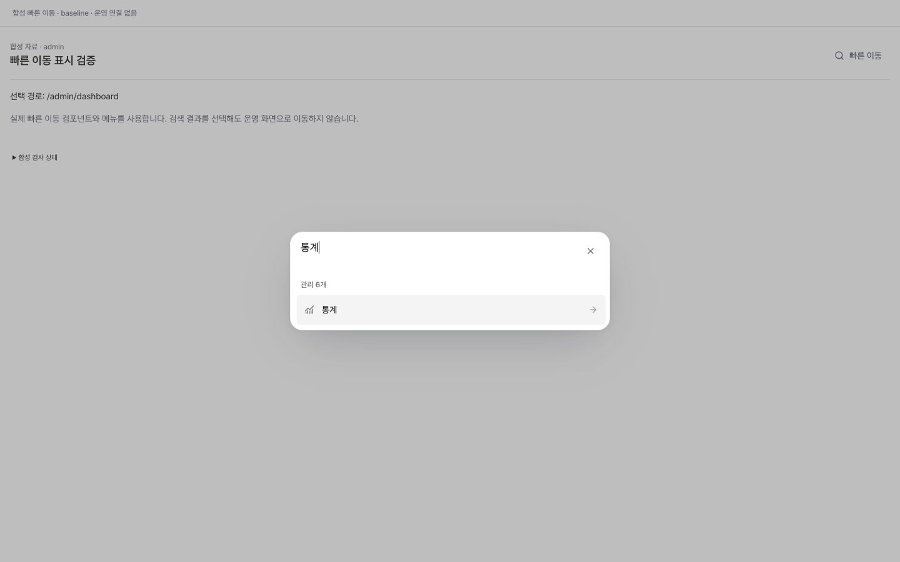
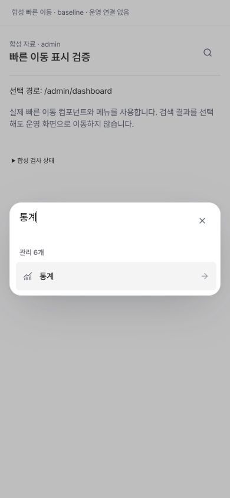
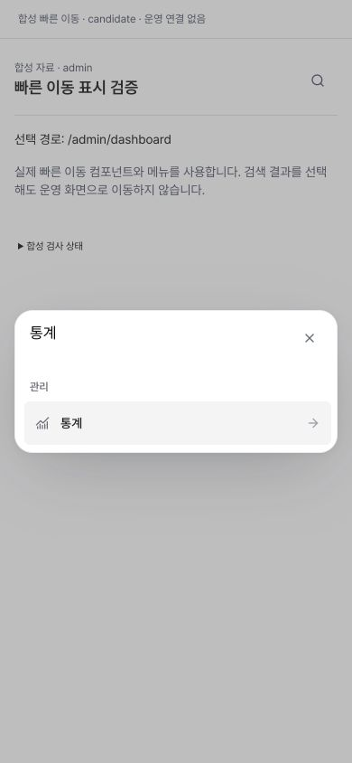

# 빠른 이동 검색 그룹 제목 정확성

## 문제와 변경

검색 결과가 한 개여도 그룹 제목에는 검색 전 허용 메뉴 전체 개수가 남았다. `통계` 한 결과에서 admin 입력은 `관리 6개`, 관리팀 입력은 `관리 4개`를 보여준다. 그룹 제목을 그룹명만 표시하도록 바꾸고, 기존 cmdk 검색·정렬·메뉴 권한·경로·키보드·초점·미저장 이동 보호를 유지했다. 제품 코드는 `command-search.tsx` 한 줄이며 공유 스타일·API·SQL·권한·의존성 변경은 없다.

기준은 기존 TIPS 빠른 이동, 실제 CommandSearch/cmdk/Dialog와 navigation factory다. 새 표현 패턴이나 결과 집계 기능을 도입하지 않는다.

## 검증

- 수정 전 실제 cmdk 테스트에서 `통계` 결과 1개와 `관리 4개` 대 기대 `관리`의 불일치로 예상 실패를 확인했다. admin이 아닌 관리팀 fixture이므로 기존 운영 캡처의 6개와 다르다.
- 현재 영향 범위 16파일 302개 통과, 실패/skip 0. 직접 42개 결과는 302개에 포함되며 중복 합산하지 않는다. 실제 cmdk의 0·1·여러 검색 결과·검색 해제, 필터 후 Enter, Escape 초점 복귀, 교사/조교 허용 메뉴, 미저장 초안 보호를 포함한다.
- TypeScript, 전체 ESLint, production build exit 0. ESLint 기존 경고 15개, 오류 0. 각 실행 전후 소스 지문 동일.
- 기존 승인된 로컬 CI 대체 매핑에서 영향받은 그룹/직접 소비자는 현재 검사로 연결하고, 불변 DB/probe/Linux 및 무관 범위는 동일 입력·근거 해시가 확인된 기록만 재사용한다. 원격 CI 성공을 주장하지 않는다.

## 실제 Chrome 합성 화면

실제 컴포넌트·cmdk·Radix Dialog·메뉴·CSS를 사용하고 auth/router만 합성 경계로 대체했다. 로컬 정적 서버는 `127.0.0.1:4191`에만 열었으며 업무 데이터/DB/외부 요청이 없다. 이는 실제 계정 로그인/RLS 검증이 아니다.

| 단계 | 관측 결과 |
|---|---|
| 같은 admin fixture, `통계`,1440×900 | 수정 전 `관리 6개`, 수정 후 `관리`; 결과는 모두 통계 한 항목 |
| 같은 조건,390×844 | 동일한 개수 오표시 제거. dialog x16~374,y343~501, 페이지 가로 넘침 없음 |
| 없는 메뉴 검색 | 결과0, `일치하는 메뉴가 없습니다.` |
| `수업` 검색 | 수업계획·수업관리 2결과, 운영·관리 그룹명만 표시 |
| 검색 해제 | 허용 메뉴25개와 운영/영어/관리/설정 그룹 복귀 |
| 필터 후 Enter | dialog가 닫히고 합성 목적지가 `/admin/statistics`로 변경 |
| 다시 열고 Escape | dialog0, 원래 `빠른 이동 열기` 버튼으로 초점 복귀 |

합성 화면의 미저장 편집기 전체 연결은 별도 실제 SiteHeader 통합 테스트로 검증했다. 390px는 반응형 viewport이며 물리 휴대폰 검증은 아니다. 최종 진단의 외부 요청 차단 기록/런타임 오류는 0이었다. 원래 서버 세션 Ctrl-C로 정상 종료하고 리스너 해제, 임시 탭 종료와 viewport 복원을 확인했다.

수정 전/후 같은 조건의 캡처:

## 출시 인수와 한계

검증 기준 base/main은 `78a9f9f3692079663703565ed714720563dcdff8`, 직전 확인 Production은 `6ZYrPe5qxGqh3EotjagQTKWS6XjY`다. 최종 head/tree·필수 base/head 검사·독립 검토·실제 배포/운영 읽기 관측은 별도 출시 인수에 연결한다. 이 문서만으로 운영 배포 완료를 뜻하지 않는다.

작은 표시 정확성 수정으로 별도 고효과 개선 건수를 추가하지 않고 12/100을 유지한다. PR173의 자연 31명 이상 운영 추가 조회 보류도 유지한다.
