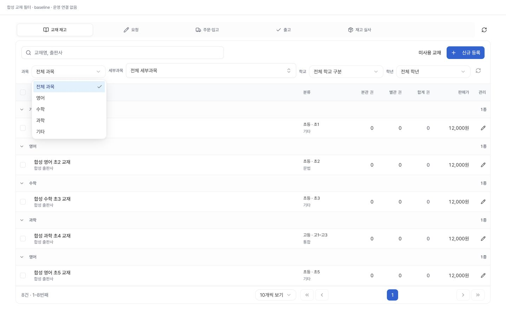
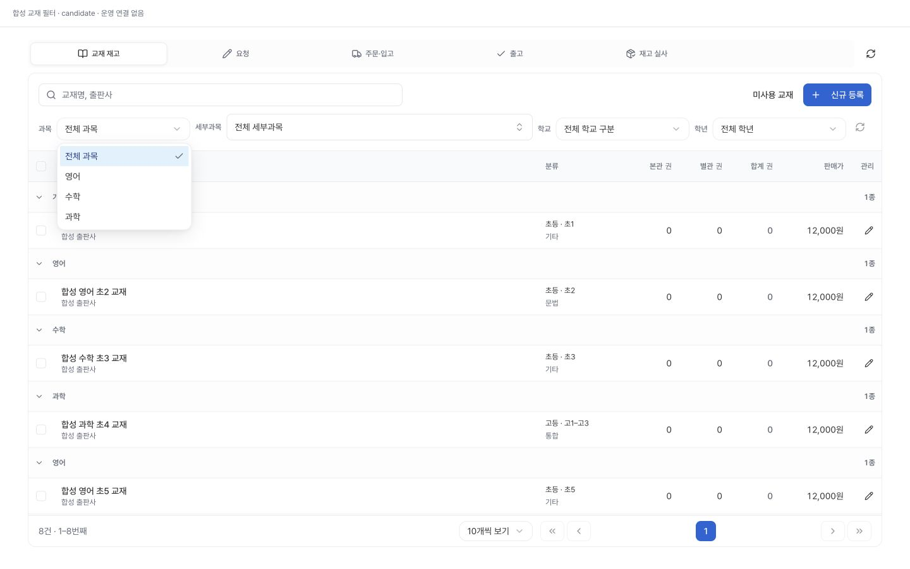
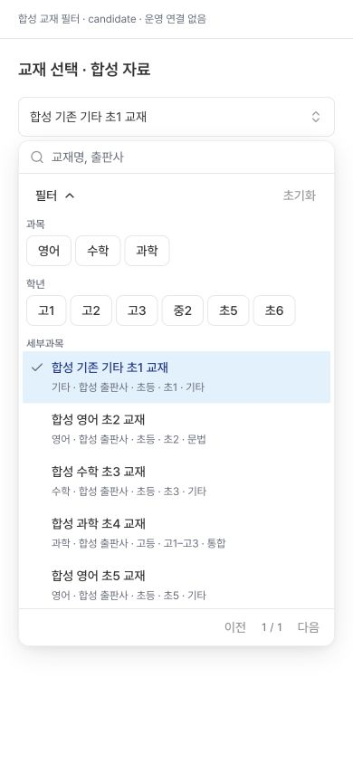
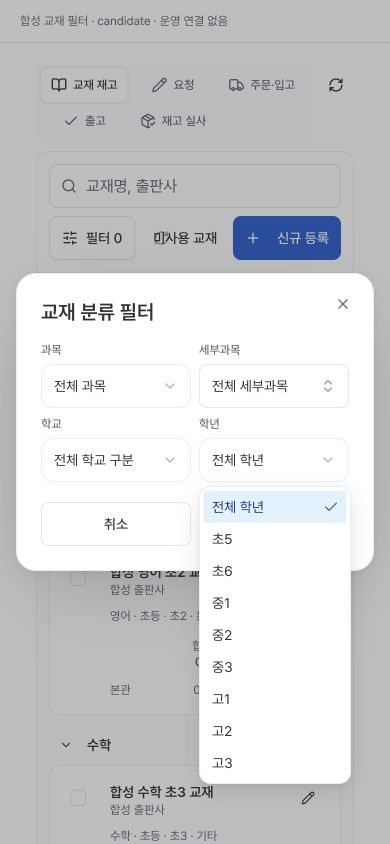

# 교재 조회 필터 선택지 정리

교재를 조회할 때 과목 `기타`, 학년 `초1~초4`를 선택지에서 제외한다. 목록·재고 실사·모바일 목록 필터·서버/로컬 교재 선택·수업 상세 교재 선택에서 같은 조회 정책을 사용한다.

데이터와 작성 선택지는 유지한다. 전역 taxonomy, 서버의 원본 facet 응답 검증, 교재 행과 선택된 교재, 등록·편집·일괄 수정·공급처 설정, DB enum/컬럼/값과 권한/API를 바꾸지 않는다. 세부과목 이름 `기타`와 초등학교 구분·초5/초6은 유지한다.

기존 주소의 제외 조건은 첫 조회 전에 전체로 바꾸고 페이지1로 돌아간다. 검색·학교급·페이지 크기·상세와 관계없는 주소 값은 보존한다. 해제한 과목의 세부과목도 함께 해제하고, 다중 과목 선택에 유효한 과목이 남으면 해당 세부조건을 유지한다.

## 로컬 검사

직접4파일91개와 관련31파일955개를 실행했다. 관련검사에서 기존 테스트 로더의 새 모듈 연결2건, 정책 경로 이름의 구조 단언2건, 기존 통신오류 fixture와 권한거부 기대의 모순1건이 드러났다. baseline에서도 마지막 한 건은 같은 실패가 재현됐다. 실제 제품 권한 처리와 단언을 약화하지 않고 테스트를 보완했고 해당3파일125개가 통과했다. 권한거부 시 과거 페이지 폐기/복원 방지1건을 추가하여 고유검사 총1047개가 통과했다. fail/skip/cancel0인 최종 범위를 기존 실패 로그와 구분한다.

TypeScript·전체 ESLint·production build exit0. 기존 lint경고15개. 나중에 변경한 테스트3파일의 ESLint도 exit0. 앱 소스·SQL·의존성의 변경/불변 지문은 별도 검증 영수증으로 대조한다. 전체제품·운영·실제기기 검증이라고 하지 않는다.

## 실제 Chrome의 합성 화면

운영 연결 없이 loopback 서버와 정적 자산만 사용하며 CSP connect-src none, GET/HEAD전용이다. 실제 컴포넌트/읽기소비자와 가상 자료·인증·transport/Next navigation을 결합했다. desktop1440×900, 모바일390×844는 브라우저 viewport다.

- 전체 목록에 기타/저학년의 기존 교재가 그대로 보인다.
- 조회 과목은 영어·수학·과학, 학년은 초5/6·중1~3·고1~3이다. 세부과목 기타는 그대로다.
- 교재 선택의 영어·초5 적용, 필터초기화, 기존 기타교재 제목검색 및 기존선택 표시를 확인했다.
- 실사와 로컬 선택에도 같은 옵션이며, 수업 기본 기타/초2는 전체과목/전체학년으로 해제되고 학교급은 초등으로 보존된다. 전체보기에서 다른 학교급도 조회한다.
- old URL first RPC의 subject/grade/subSubject all,page1,pageSize20,search/학교급 보존을 합성화면과 실제 소비자 단위검사로 확인했다.
- 모바일 범위에 가로 넘침 없음. 모바일 필터 취소 후 원래 버튼에 초점복귀 확인.
- 합성 navigation의 URL 객체 identity와 native history 구독을 설치된 Next 동작에 맞춘 뒤 oldURL 초기화를 재확인했다. search와4분류 모두 전체, page1/pageSize20, canonical URL 동기화가 정상이다. 제품 코드는 추가 변경하지 않았고 최초 fixture 번들을 보존했다.

임시 서버는 원래 세션 Ctrl-C로 정상 종료(exit0)하고4192리스너 없음, 브라우저 viewport 해제와 임시 합성 탭 닫기를 확인했다. 기존 운영 Chrome은 대시보드에 유지했다.

이번 필터 변경의 원격 게시/배포/운영 검사는 아직 실행하지 않았다. 별도 개별 승인 범위이며 PR174 승인에 포함하지 않는다.12/100유지, 기존 PR173 자연31명 이상 관측 등 보류유지.

## 동일 상태 비교

변경 전/후 모두 같은 합성8교재·전체조건·밝은테마·1440×900이다. 캡처는 필터 선택지 변화를 확인하며 실제 운영자료가 아니다.

