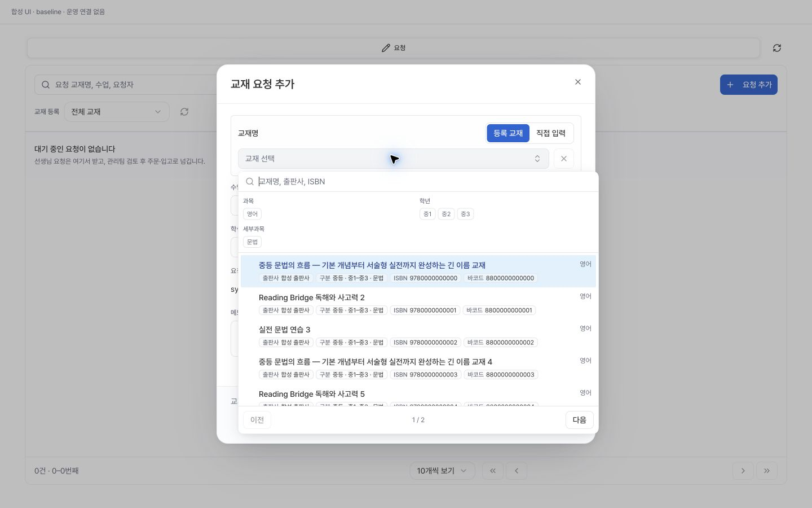
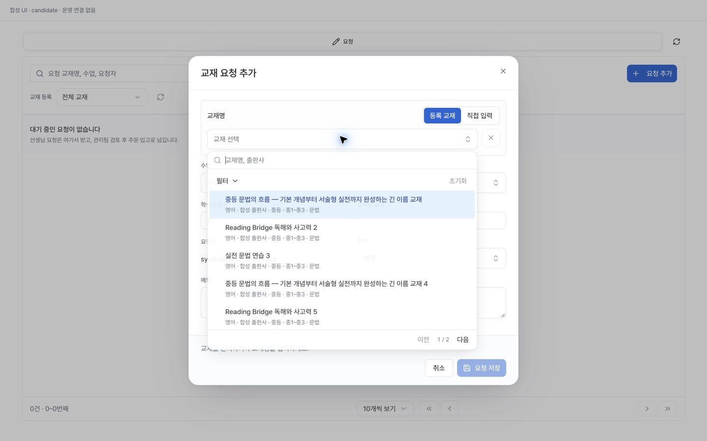
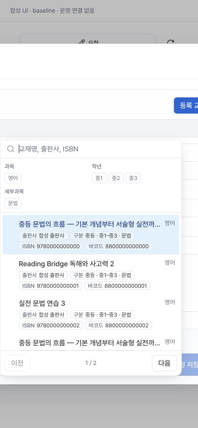
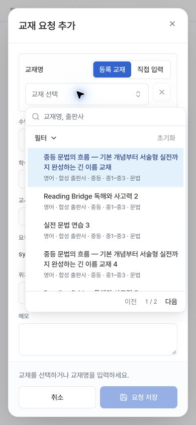

# 교재 선택창 통일 및 사용하지 않는 식별 코드 제거

## 문제와 범위

사용자는 교재요청의 교재·수업 선택창이 복잡하고 서로 일관되지 않으며 ISBN·바코드 칸을 사용하지 않는다고 보고했다. 기존 운영자 선택창은 640px 패널에 필터 칩과 메타 배지를 항상 표시했고, 교사 선택창은 다른 공용 구현을 사용했다.

현재 main 기준은 `86ee9f2bbf3eafdec0f21cd1b6d568f87d46e607`이다. 운영자·교사 선택창을 기존 공용 SearchCombobox와 선택행·페이지 footer 합성으로 맞췄다. 기존 학생/수업 관리의 입력·팝오버를 시각 기준으로 사용했다. 필터 다중 선택, 제한된 서버 페이지 조회, 선택된 UUID의 별도 resolve, 역할별 저장 계약은 보존했다.

ISBN·바코드는 교재 등록·편집 입력, 안내, 선택 결과 표시에서 제거했다. `upsertTextbookMaster`는 두 속성을 쓰기 payload에 포함하지 않는다. 빈 문자열이나 null로 덮어쓰지 않는다. 기존 DB 컬럼·값·마이그레이션과 엄격히 대조하는 참조 wire model/서비스는 변경하지 않았다. 서버가 제공하는 과거 식별 코드의 조회·검색 호환은 유지되며 화면에서 사용을 요구하지 않는다.

## 화면 비교

운영 개인정보를 복사하지 않은 동일 합성 자료, 동일 밝은 테마, 선택 전 첫 페이지다. 실제 React workspace/서비스/제어기를 번들링했고 인증 공급자·Next 이동·외부 transport만 메모리 대체했다. 모든 네트워크는 CSP와 런타임 guard로 차단한다. 실제 운영 결과를 나타내는 이미지가 아니다.

| 폭 | 변경 전 | 변경 후 |
| --- | --- | --- |
| 1440×900 |  |  |
| 390×844 |  |  |

추가 확인: [펼친 필터](textbook-selection-ui-20261025/candidate-book-filters-390.jpg), [교사·다크 모드](textbook-selection-ui-20261025/candidate-teacher-dark-390.jpg), [교재 등록 폼](textbook-selection-ui-20261025/candidate-master-1440.jpg).

## 로컬 검증

- 교재·역할·선택 서비스/모델 및 신규 payload 회귀 73/73.
- 기존 workspace/reference UI 회귀 122/122. 이전 ISBN 입력·미러링 기대를 제거된 정책에 맞게 정정했고, 저장 실패 후 가격 초안·초점·단일 동시 쓰기·재시도는 유지했다.
- 교재 업무와 공용 디자인·초점·wire 계약 550/550.
- 추가 교사 선택창 wiring 3/3: 한글 조합 중 조회 보류, 종료 뒤 확정 검색, 빈 카탈로그/검색 0건/오류 구분 및 원 검색어 재시도, 15+1 페이지와 긴 라벨/선택 UUID/합성 제출 연결.
- 위 서로 다른 사례 총 748 PASS, 실패·skip 0. 마지막 모바일 최소 폭 보완 뒤 공유 선택/폼/초점 및 신규 회귀 26/26 재검증했으며 총수에 중복 가산하지 않았다.
- 최종 production build exit 0. 자격증명 없는 clean environment와 connect 이전 차단 guard로 실행했다. 실제 서비스 연결이나 운영 저장을 하지 않았다.
- TypeScript·lint·query/migration 검토 및 exact-source 독립 리뷰 결과는 출시 인수 기록에 별도로 고정한다. 원격 필수 CI 상태와 로컬 회귀를 서로 대체해 표시하지 않는다.

서비스 회귀는 실제 쓰기 payload에서 두 키가 없는지를 검증한다. 합성 transport의 저장 결과는 운영 DB에서 실데이터 보존을 재조회한 증거가 아니다. 실제 운영에서 테스트 교재를 생성·수정하지 않는다.

## 정식 Chrome 검증

1440×900, 390×844에서 이름·보조정보·필터·페이지의 배치를 비교했다. 모바일 폭을 216px trigger에 그대로 맞추면 긴 이름이 지나치게 좁아지는 점을 발견해 opt-in 선택창만 최소 `min(20rem, 100vw - 2rem)`을 적용했다. 기존 소비자는 기본값을 유지한다.

최종 390×600에서 펼친 필터와 320px 선택창의 페이지 버튼이 viewport 안에 있었고 문서 가로 넘침은 0px였다. 실제 모바일 기기나 화면 키보드로 측정한 결과는 아니다.

교재 다음 페이지(21–23) 선택 유지, 수업 ArrowDown/Enter 선택, Escape 뒤 원래 수업 trigger 초점 복귀, 로컬 출판사 한글 검색·키보드 선택, 실패 안내에서 재시도 후 20개 선택지 로드, 없는 검색어의 빈 결과를 확인했다. 교사 폼은 같은 행/페이지 구성으로 15개 선택지와 제목 필수 표시를 확인했다. 신규/기존 교재 폼 모두 ISBN·바코드 입력이 없었다. 브라우저에서 저장은 하지 않았다.

초기 하네스의 위치 resolve 응답에 필수 option이 빠져 소비자 오류가 있었다. 양쪽 하네스 DTO를 보완하고 정상 상태에서 비교 이미지를 다시 확보했다. 제품 결함이나 운영 장애로 분류하지 않는다. viewport 재탐색 뒤 캡처 해상도가 어긋난 중간 이미지는 최종 비교에서 제외하고 동일 1440×900/390×844로 다시 저장했다.

## 출시 경계와 원복

앱 변경만 출시한다. SQL·DB 컬럼·권한·외부 알림·새 라이브러리·환경 설정 변경은 없다. 검증된 이전 운영 앱은 main `86ee9f2b` 및 Vercel `DPeBsurUUnn6u5Zr897dkJeHb8DU`다. 문제가 생기면 해당 앱 소스 기준으로 정상 PR/release 원복하며 DB 복구나 식별 코드 데이터 삭제는 필요하지 않다.

현재 기록은 로컬 검증 단계다. PR 필수 체크·정확한 head/base·독립 리뷰·운영 배포와 실제 읽기·비저장 UI 인수를 마친 뒤에만 완료로 집계한다. 과거 교재요청 자연 행 0건 관측 보류는 이번 독립 개선의 결함이나 선행 조건으로 세지 않는다.
