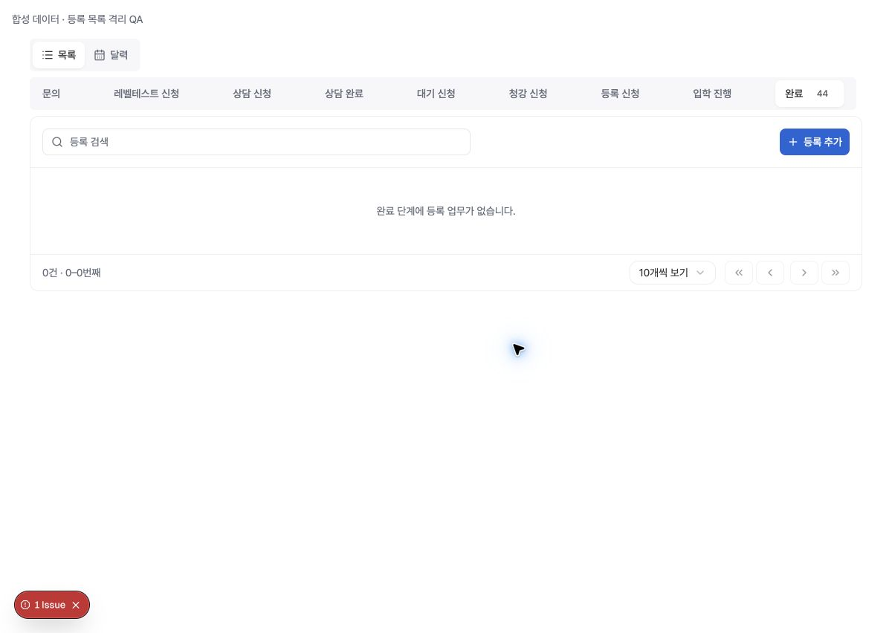
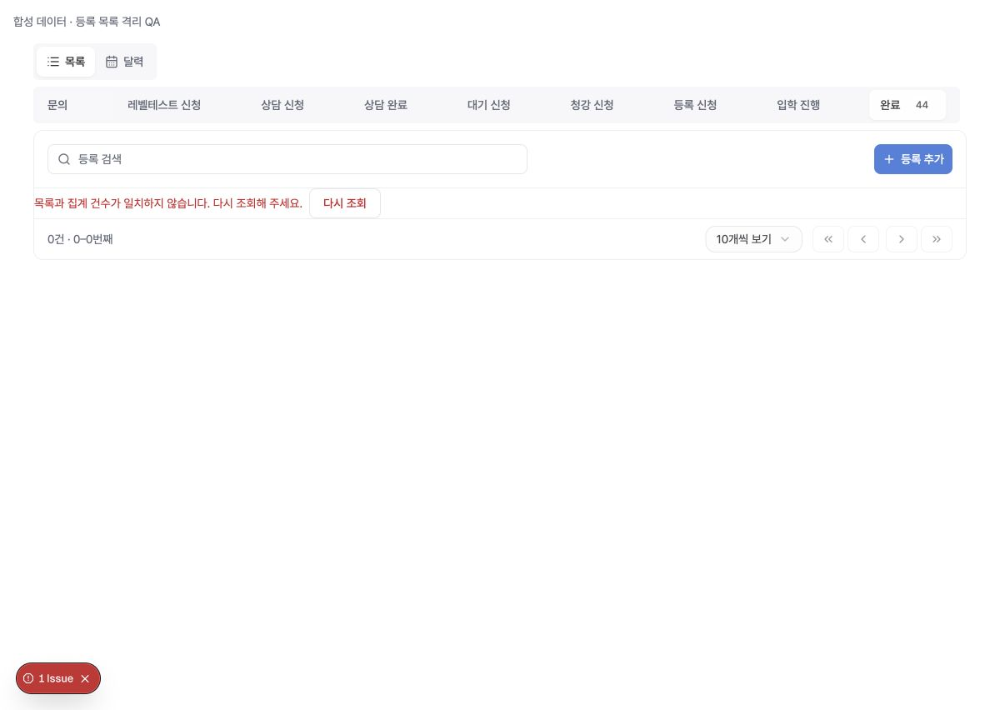
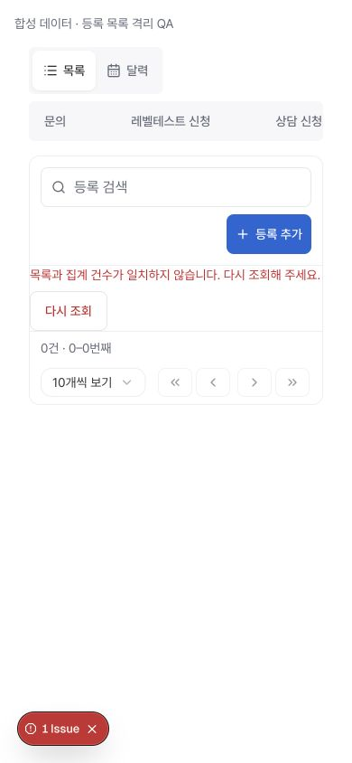
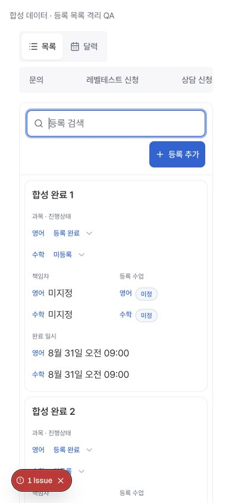

# 등록 완료 목록의 설명 없는 빈 상태 — 격리 QA

## 판정과 범위

2026-10-10 05:22 UTC 운영의 `완료 44건 / 빈 목록 / 갱신 문구 없음` 관찰은 유효한 결함 후보다. **그 운영 관찰의 원인은 미확정**이며, 이 변경을 운영 원인 수정이나 상세 오류 해결로 판단하지 않는다.

본 작업의 운영 조회 1회에서는 등록 신청 → 완료 → 390px에서 원래 1200px로 복원 후 완료 목록이 정상 표시됐다. 동일 증상을 만들 수 있는 두 독립 조회의 불일치와 잘못된 빈 상태 안내는 실제 프런트엔드에 합성 응답을 전달해 재현하고 수정했다. 운영 반복 새로고침, 저장, 학생 변경, 승인, 발송, SQL 변경, 부하 검사는 하지 않았다.

- 기준 main 및 마지막 성공한 Production 배포: `bdf13d0db1d0664c2a6b366b176818f6bfc3d38b` (PR131).
- 확인한 배포: GitHub deployment `6965636016`, success.
- 병행 draft PR132: `a29859d3130b7586bdc096652b11296c5d5f62eb`, 연락처 보호. 서비스·워크스페이스·회귀 파일이 겹치므로 병합 전 통합 검증 필요.
- 병행 draft PR133: `7581b6990e0d3852ace0b4c0c5596e436a636f62`, 개인 API. 본 수정의 직접 구현 중복 없음.
- PR131 `registration-detail-observation.ts`는 기준과 byte-identical. 진단 호출도 변경하지 않았고 로그를 추가하지 않았다.

## 운영 조회와 합성 검증의 차이

입력 증거: `task-3/tips-mobile-scroll-qa-2026-10-10-0520.md`, `completed-list-empty-0522.jpg`. 이전 03:28 정상 상세 이력은 별도 관찰이며 이번 상세 검증을 대신하지 않는다.

운영 임시 Chrome 탭 하나에서 조회 UI만 사용했다. 초기 문의를 읽은 뒤 390×844에서 등록 신청과 완료를 선택하고 1200×852로 복원했다. 앱이 보낸 읽기 RPC의 메타데이터·숫자·상태만 확인했으며 학생 이름, 식별자, 연락처, 행 payload를 파일이나 fixture로 저장하지 않았다. 원래 뷰포트를 복원하고 탭을 종료했다.

| 운영 요청 | 조건 | 결과 |
| --- | --- | --- |
| 등록 신청 목록 | search 빈 문자열, statuses 빈 배열, owner null, page 1, size 15 | HTTP 200, totalCount 0, rows 0 |
| 등록 신청 통계 | 위와 같은 필터 | HTTP 200, total 0, byView.completed 44 |
| 완료 목록 | view completed, 나머지 동일 | HTTP 200, totalCount 44, rows 15 |
| 완료 통계 | 위와 같은 필터 | HTTP 200, total 44, byView.completed 44 |
| 완료 UI | 원래 뷰포트로 복원 | 선택 완료44, 보이는 부모 15개, 검색어·갱신·오류 없음 |

모바일/데스크톱 DOM은 같은 15개 항목을 각각 렌더링하므로 단순 전체 DOM 행 수 30과 실제 표시 부모 15개를 구별했다. 상세는 이번 작업에서 운영 진입하지 않았으며 과거 간헐 상세 오류는 계속 미검증이다.

합성 브라우저는 실제 목록·hook·DTO 서비스·공통 CSS/컴포넌트를 사용하되 **인증, Supabase transport, 앱 외곽 레이아웃은 임시 사본에서 대체**했다. 외부 연결은 CSP `connect-src 'self'`로 제한했다. 운영 DB/RLS/배포 검증을 대신하지 않는다. 브라우저 fixture는 10행, 별도 실제 hook 회귀는 운영에서 관찰한 15행/44건과 마지막 페이지 14행도 검사했다. screenshot의 개발 Issue 배지는 설치된 HWP 확장이 html 속성을 추가한 SSR 경고이며 이 목록 오류와 별개다.

## 원인 분석과 최소 수정

- 통계와 목록은 독립 읽기다. 같은 범위에서 통계 `total=44`, 페이지 `totalCount=0, rows=[]`가 각각 성공하면 기존 UI가 정확히 완료44와 단정적인 빈 상태를 함께 표시했다. 통계는 60초 캐시도 사용한다. 실제 05:22 응답이 이 조합이었는지는 알 수 없다.
- DTO의 모양은 유효하지만 선택 단계에 대응하는 트랙이 없는 부모를 반환하면, 수락된 페이지의 클라이언트 표현 필터가 모든 부모를 제거할 수 있다. 운영에서 이런 DTO를 관찰하지는 않았다.
- 이전 단계가 빈 목록일 때 새 탭 조회가 지연되거나 실패하면, 이전 빈 결과를 새 단계의 빈 결과로 설명했다. 기존 비어 있지 않은 수락 결과 유지 동작은 그대로 둔다.
- 페이지1의 `totalCount=44, rows=[]` 자체는 기존 DTO 검증이 오류로 거부한다. 페이지 범위 초과는 기존 controller가 마지막 페이지를 다시 읽는다. 정상 재현에서는 화면 크기 변경이 새 조회를 만들지 않는다.

수정은 설명 없는 빈 상태에 한정한다. 대기·실패 중에는 확정적인 빈 상태 문구를 숨긴다. 성공 후 표시 행이 없는데 페이지 건수가 양수이거나, **같은 수락 필터의 통계 total**이 양수라면 `목록과 집계 건수가 일치하지 않습니다. 다시 조회해 주세요.`와 수동 재조회를 제공한다. 전체 담당 탭 건수 `byView`를 내 담당·검색의 빈 목록 판정에 사용하지 않는다.

재조회는 검색 입력으로 초점을 돌리고 통계 캐시만 무효화한 뒤 현재 목록과 통계를 읽는다. 자동 재시도·폴링을 추가하지 않는다. 새 버튼은 공통 Button의 `form` 크기(모바일 44px)를 사용한다. SQL, 권한, 데이터 매핑, 연락처 처리, 저장, 상세 코드는 바꾸지 않았다.

## 검증

- 새 실제 hook/service/workspace 합성 회귀 13개 통과. 불일치 응답 순서 2종, pending/error, 정상 빈 목록/검색/내 담당, 트랙 없는/다른 단계 DTO, 오래된 응답, 44건·15행 페이지/리사이즈, 재조회 후 정상 목록 및 실제 0건, 최초 권한 실패를 포함한다.
- 수정 전 bdf13d0d에 같은 초기 11개 회귀를 실행: 5 통과, **6 실패**. 실패는 통계 불일치 2종, pending/error 2종, 트랙 불일치 2종이다. 수정 후 신규 전체 13개 통과.
- 관련 9개 테스트 파일 **272/272 통과**. 공통 목록/버튼/탭 디자인 계약 **22/22 통과**.
- TypeScript noEmit 통과. 변경 파일 ESLint 오류 0, 기존 service unused 경고 3개. diff whitespace 검사 통과.
- 로컬 free-tier tasks worktree 검사 및 migration layout 검사 통과. SQL 변경 없음. GitHub 유료 검사 실행/재실행 없음.
- 초기 확장 검사에서 공용 JSDOM teardown 변경 때문에 청강 초안 테스트가 실패했다. 공용 harness 변경을 제거했고 최종 전체 검사는 통과했다. 원본 main pagination 85개도 통과. 기존 harness의 React legacy input/focus 경고는 원본에서도 관찰되며 관련 없는 PR132의 harness 수정은 가져오지 않았다.
- Chromium 실제 합성 UI: 1200×852 및 390×844에서 전후 화면 확인. 모바일 문서 가로 넘침 없음, 재조회 버튼 44px, Enter 재조회 후 검색 초점 유지 및 10개 정상 행 복구. 화면 복원 확인.

사용한 주요 명령(로컬 Node 24.21.0; 브라우저 Next 실행은 공식 checksum 확인한 Node 22.23.3):

```sh
node --test --experimental-strip-types tests/ops-task-numbered-pagination.test.mjs tests/ops-task-numbered-service.test.mjs tests/numbered-page-controller.test.mjs tests/ops-task-page-stats-cache.test.mjs tests/registration-detail-observation.test.mjs tests/registration-case-list-model.test.mjs tests/registration-list-toolbar.test.mjs tests/premium-registration-list.test.mjs tests/registration-tab-count-layout.test.mjs
node --test --experimental-strip-types tests/data-table-pagination.test.mjs tests/data-table-surface.test.mjs tests/common-controls-ui.test.mjs tests/workspace-tabs.test.mjs
node node_modules/typescript/bin/tsc --noEmit --incremental false
node scripts/verify-free-tier-query-contracts.mjs --base bdf13d0db1d0664c2a6b366b176818f6bfc3d38b --worktree --surface tasks
```

## 합성 화면 증거

동일한 통계44/페이지0 응답, 같은 desktop 뷰포트:





모바일 불일치 안내와 사용자 재조회 후 복구:





운영 배포·merge는 수행하지 않는다. draft PR은 부모가 병행 변경과 조율한 뒤 현재 main 기준 통합 및 운영 재검증을 해야 한다. 최초 관찰의 원인과 과거 상세 오류는 남은 미확정 사항이다.
