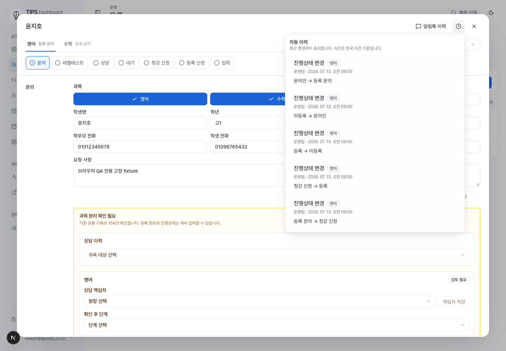
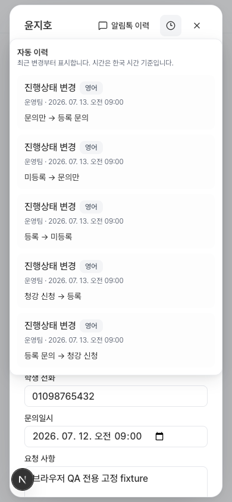
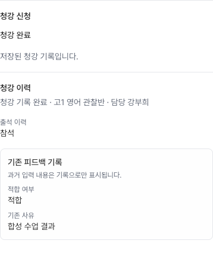
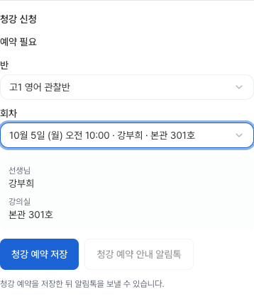

# 등록 자유 기록·청강 정리 검토 자료

> 최초 `7626967` 검증 기록입니다. 독립 검토에서 발견한 세 계약 누락 및 수정 검증은 [후속 검토 자료](registration-free-recording-review-fixes-20261004.md)를 기준으로 보세요. 최초의 notification source 0 기대는 호환 계약이 아니었으며 후속 수정에서 복구했습니다.

기준: 배포된 main `010c36d27a76b2fdb8f78edec99d7c3c9bbbd1b0`. 원본 dirty checkout은 수정하지 않았다. 이 변경은 로컬 검토용이며 운영 DB 적용, 배포, 외부 발송은 실행하지 않았다.

## 동작과 범위

관리팀·원장은 기존 과목별 진행상태에서 **청강 신청**, **등록**, **미등록**, **문의만**을 포함한 13개 값을 정보 완성도나 예약·참석 여부와 관계없이 기록한다. 진행상태 변경은 학생·수강 등록, 예약, MakeEdu 실행을 만들지 않는다. 기존 요청 사항을 자유 메모로 유지한다.

청강 화면에서는 캠퍼스·교재·진도 요약과 교사 전달/보고 요청, 참석 확인·원장 결정 입력을 제거했다. 이전 참석·보고·결정 기록은 읽기 전용 이력으로 남긴다. 전역 수업 정보와 저장된 스냅샷은 보존한다. 교사 확인 없이 수동 진행상태를 바꿀 수 있으며, 실제 예약·수강 등록·발송의 참조/시간/권한/중복 실행 검증은 유지한다.

현재반 대기 의향은 반이 정해지기 전에도 저장할 수 있다. 반을 입력하면 실제 존재하는 반이어야 하며 대기 종류와 일치해야 한다. 시계 아이콘 이력에는 수동 상태 변경과 정보 저장을 복원하고 실제 시각으로 정렬한다. 상태 전후를 바로 보여 주며, 내용 없는 상세 펼침과 공통 정보의 원시 JSON 표시는 제거한다.

무과목 접수에 새로운 결과 속성을 만드는 제안은 이번 범위에서 제외했다. 공통 정보·과목 없는 접수 허용은 기존 계약이며 이를 위한 새 도메인 모델은 추가하지 않았다.

## 소유 파일

모든 제품 변경은 `src/features/tasks/` 아래 다음 15개 파일에 한정된다.

- 진행상태: `registration-workflow-status.js`, `registration-workflow-status.d.ts`, `registration-application-model.ts`, `registration-case-list.tsx`, `registration-case-list-model.ts`
- 선택 정보·청강: `registration-application-track-actions.tsx`, `registration-track-editor.tsx`, `registration-observation-editor.tsx`, `registration-observation-feedback-panel.tsx`, `registration-observation-model.ts`
- 이력·계약·합성 검증: `registration-track-service.ts`, `registration-track-history.js`, `registration-history-timeline.tsx`, `registration-application-history-action.tsx`, `registration-track-fixtures.ts`

회귀 검증은 기존 관련 테스트 11개 파일을 갱신했다. DB 변경과 실제 SQLSTATE 검증은 아래 두 파일이다.

- `supabase/migrations/20261004140440_registration_free_recording.sql`
- `supabase/tests/registration_free_recording_test.sql`

## DB 변경과 보존 경계

정렬된 전체 마이그레이션 체인의 최종 함수를 기준으로 `set_registration_workflow_status_v1_impl`의 상태 허용 목록과 `save_registration_waiting_details_v2_impl`의 선택 정보 검증만 조정했다. 과거 청강 복귀 상태의 필수 결합 제약을 제거하고, 대기 반 미지정 저장을 허용한다. 기존 컬럼·행·복귀 메타데이터는 삭제하거나 backfill하지 않는다. 인증, RLS/ACL, manager fence, 잠금, revision, idempotency receipt와 audit는 유지한다. 보안 정책 변경은 없다.

합성 로컬 Supabase Postgres에 schema-only baseline, 기존 prerequisite/후속 마이그레이션과 새 migration을 적용했다. 외부 통신이 없는 Docker 네트워크에서 실행했다. 적용 파일 목록은 [db-migration-list.txt](registration-free-recording-20261004/db-migration-list.txt)에 있다. 운영 데이터나 운영 DB 연결은 사용하지 않았다.

## 검증 결과

| 검증 | 결과 |
| --- | --- |
| 등록 관련 Node 테스트 | 557/557 통과, 기존 isolated provider-zero 검사 포함 |
| 공통 디자인 계약 | 63/63 통과 |
| 신규 pgTAP | [21/21 통과](registration-free-recording-20261004/pgtap-free-recording.txt): 169 상태 조합, 선택 정보, 정확한 23514/22023/23503/42501, 재실행, 권한 거부, 역사 보존, 부수 실행 없음 |
| 기존 manager fence pgTAP | [28/28 통과](registration-free-recording-20261004/pgtap-manager-fence.txt) |
| 전체 ESLint | 오류 0, 미수정 파일의 기존 경고 7 |
| TypeScript | `tsc --noEmit` 통과 |
| 운영 빌드 | `next build --webpack` 통과. 로컬에 public class 환경 설정이 없어 해당 페이지는 기존 unconfigured fallback 사용 |
| diff | `git diff --check` 통과 |

pgTAP는 모두 트랜잭션 rollback으로 끝난다. 테스트가 증명하는 것은 로컬 최종 함수 동작이며 운영 적용 성공을 뜻하지 않는다.

실제 `/admin/registration?fixture=registration-subject-tracks&fixtureRole=english_admin`에서 기존 합성 접수를 열어 `청강 신청 → 등록 → 미등록 → 문의만 → 등록 문의`를 기록했다. receipt 5개, 예약 수 변화 없음, 외부 실행 0, 브라우저 오류 0이었다. 1440px/390px 화면을 확인했고 모바일 문서 폭 390px, 팝오버 x=17·폭=356px, Escape 후 시계 버튼 포커스 복원을 확인했다. [상세 결과](registration-free-recording-20261004/existing-debug.json).




기존 preview fixture가 청강 runtime을 비활성화하므로 청강은 실제 `RegistrationApplication`과 기존 합성 observation fixture를 사용하는 일시적인 컴포넌트 harness에서 검증했다. admin/staff는 보존된 이력을 읽고 교사/조교는 상태 입력이 비활성화되며 참석 확인·피드백 요청 동작이 없다. [역할별 결과](registration-free-recording-20261004/trial-roles.json). 이 harness는 배포 코드에서 제거했다. 아래 청강 이미지는 컴포넌트 영역 캡처이며, 실제 인증 경로의 전체 화면 검증으로 주장하지 않는다. 독립 wrapper의 문서 폭은 390px viewport에서 398px였고 실제 등록 dialog 경로의 폭 검증과 구분한다.





예약 컴포넌트는 합성 미래 수업을 선택했을 때 예약 버튼이 활성화됨을 확인했으며 실제 예약을 실행하지 않았다. 반 없는 현재반 대기 정보 저장은 성공했고 알림톡 버튼은 비활성 상태를 유지했다. [결과](registration-free-recording-20261004/booking-and-waiting.json).

## 알려진 한계와 통합 시 주의

- 일반 직원의 무과목 신규 접수는 합성 receipt와 case가 생성되지만 기존 workspace의 저장 후 ownership/rehydration 경로에서 저장 중 표시가 유지된다. 부모 작업 지시에 따라 `ops-task-workspace.tsx`는 수정하지 않았다. 신규 접수 전체 흐름이 완료되었다고 주장하지 않는다.
- 위 청강 역할 검증은 실제 컴포넌트 harness와 DB 권한 검사다. 실제 인증 세션/운영 청강 runtime에서의 전체 경로는 조율된 release 검증에 남아 있다.
- 휴보강 승인 hotfix의 approval/planner/workspace 파일은 변경하지 않았다. 사고 대응과 동시 배포하지 않는다.
- 연락처 최소화 브랜치와 `registration-track-editor.tsx`가 겹친다. 그 브랜치의 `contactHandoffSnapshot={detail}` 입학 처리 prop 영역은 수정하지 않았으며 통합 후 함께 검토해야 한다.
- AI PR91은 이번 작업과 관계없이 일시 중지 상태다. 독립 검토와 DB/frontend 배포 순서는 부모 작업에서 조율한다.

## 재현 명령과 로컬 근거

```sh
node --test --test-reporter=tap --experimental-strip-types \
  tests/registration-workflow-status.test.mjs tests/registration-application-model.test.mjs \
  tests/registration-case-list-model.test.mjs tests/registration-track-fixtures.test.mjs \
  tests/registration-observation*.test.mjs tests/registration-track-service.test.mjs \
  tests/registration-track-history.test.mjs tests/registration-automatic-history-ui.test.mjs \
  tests/registration-application-draft-navigation.test.mjs tests/registration-status-independence.test.mjs
node node_modules/eslint/bin/eslint.js src tests middleware.ts next.config.ts
node node_modules/typescript/bin/tsc --noEmit
node node_modules/next/dist/bin/next build --webpack
```

독립 검토용 로컬 작업 폴더는 `/Users/hyunjun/Documents/Codex/2026-10-04/task-3/tips-registration`이다. 상세 로그와 재현 스크립트는 이 폴더와 나란한 `evidence/`의 `registration-suite-final.txt`, `design-contracts.txt`, `lint-final.txt`, `typecheck-final.txt`, `build-final.txt`, `browser-existing-flow.mjs`, `browser-trial-roles.mjs`, `browser-booking.mjs`, `registration-qa-page.tsx`, `apply-local-db.py`에 보존했다. 스크립트는 로컬 런타임 경로를 사용하며 브라우저 외부 요청을 차단한다. 화면의 이름·전화번호는 저장소에 있는 합성 fixture 값이다.
