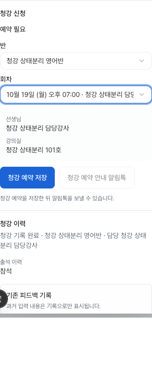
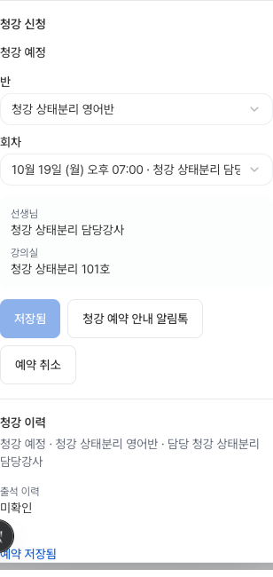

# 등록 정리 독립 검토 후 수정

이 문서는 `7626967`의 NO-GO 세 항목에 대한 후속 변경이다. 원래 기준은 main `010c36d2`이며, 운영 DB·푸시·배포·외부 발송은 수행하지 않았다. 새 결과도 독립 재검토 전까지 배포 승인으로 취급하지 않는다.

## 1. 등록 완료 알림 계약 복구

`20260909050943_operations_subject_completion_chat.sql`이 최종 상태 함수에 추가했던 계약을 새 forward migration에 그대로 보존한다. 실제 `registered` 전환은 audit UUID를 받아 `record_registration_subject_completion_v1`을 호출하고 `sourceEventIds`에 반환한다. receipt 재실행은 같은 source ID를 돌려준다. migration review 대상과 상태 변화 없는 저장에는 새 source를 만들지 않는다.

canonical 알림 source와 fanout 기록은 기존 계약이다. 수강·학생·MakeEdu 실행이나 외부 provider 호출과 구분한다. 잘못 추가했던 source 수 0 기대를 제거하고, 각 등록 전환의 source 계약과 delivery 무변화를 따로 검사한다. 기존 admission snapshot 40/40와 operations subject notification 39/39를 변경 없이 통과했다.

## 2. 과거 결정 없는 청강의 재예약

과거 `attended_feedback_pending` / `completed` / `no_show` 기록은 결정이 없어도 새 예약을 막지 않는다. 다음 네 곳을 함께 수정했다.

- 예약 RPC: 새 예약을 막는 대상은 이미 존재하는 `scheduled` 관찰이다. 인증·manager fence·session/time 검증·track 잠금·receipt 로직은 유지한다.
- manager reader: 현재 예약은 결정 없는 `scheduled` 관찰과 `scheduled` appointment의 조합이다. 전체 attempts 조회는 유지한다.
- 목록 summary view: manager reader와 같은 현재 예약 조건을 사용하며 기존 security-invoker 설정을 유지한다.
- `ops_registration_observations_open_track_key`: 결정 없는 네 상태를 묶던 unique index를 **결정 없는 scheduled 상태**로 좁힌다. 과거 상태는 독립적인 이력이고, 진행 중인 예약은 track lock·RPC guard·unique index로 한 개만 허용한다.

이 인덱스 교체는 운영 설치 전에 별도 검토할 **스키마 변경**이다. 로컬에서만 실행했으며 RLS/ACL 변경, 과거 행 backfill, 결정/출석/피드백 생성은 없다. 마이그레이션의 조회/RPC 교체는 최종 정의의 정확한 anchor를 확인하고, 불일치 시 `55000`으로 중단한다. 인덱스 설치에는 기존 5초 lock timeout을 적용한다.

새 pgTAP는 세 상태마다 실제 reader → 새 booking RPC → replay → 중복 거부 → reader/list readback을 실행한다. 저장 전 관찰·appointment 행 전체 JSON과 저장 후 값을 비교하고 decision null 및 기존 참석/보고를 확인한다. 결과는 [23/23 통과](registration-free-recording-review-fixes-20261004/history-rebooking-pgtap.txt)다. 실제 reader 응답은 `tests/fixtures/registration-observation-history-reader.json`으로 보존해 실제 consumer normalizer와 editor의 새 예약 입력에 연결했다. 기존 합성 decision fixture의 잘못된 `completed observation + scheduled appointment`도 `completed appointment`로 바로잡았다.

현재 예약이 없어도 최근 과거 청강의 읽기 전용 패널을 유지한다. 예약 실패 검증 중 확인창 뒤에만 오류가 나타나는 기존 문제를 발견해, 열린 확인창 안에서 오류를 읽고 재시도할 수 있도록 최소 수정했다.

## 3. 실제 이력 envelope의 작성자·시간 보존

`registration_common_info_updated` v1, 연락처 최소화 v2, `registration_subjects_synced`, `registration_subject_removed`의 실제 outer event envelope를 명시적으로 매핑한다. DB 행의 actor/created_at을 보존하고 private JSON·연락처·메모는 display metadata에 복사하지 않는다. `registration_fact_saved`도 같은 안전한 경로를 사용한다. 실제 시각이 없는 행은 계속 시간 확인 불가로 남는다.

회귀 검사는 SQL producer 모양의 row → 실제 `mapTrackEvent` → 실제 history builder를 통과시켜 최신순, 실제 actor, v1/v2, subject removal, private payload 제외와 진짜 unknown 시간을 확인한다. fixture가 임의의 canonical wrapper를 만들어 문제를 감추지 않는다.

## 검증

| 경계 | 결과 |
| --- | --- |
| CI-selected 현행 등록 DB 계약 29파일 + 새 2파일 | [837/837 통과](registration-free-recording-review-fixes-20261004/active-db-results.json) |
| 기존 과목 완료 알림 계약 | [39/39 통과](registration-free-recording-review-fixes-20261004/subject-notification-pgtap.txt) |
| 기존 admission/roster 계약 | 위 집계에 포함, [40/40 통과](registration-free-recording-review-fixes-20261004/admission-contract-pgtap.txt) |
| 자유 기록 | 위 집계에 포함, [22/22 통과](registration-free-recording-review-fixes-20261004/free-recording-pgtap.txt), 169 상태 조합 |
| 전체 등록 Node 검사 | [1,501/1,501 통과, skip 0](registration-free-recording-review-fixes-20261004/final-validation.txt) |
| 전체 ESLint / TypeScript / production build | 오류 0(기존 미수정 파일 경고 7) / 통과 / 통과 |
| 연락처 브랜치 호환성 | `393a91f..0e6a4a3`의 editor+workspace test patch `git apply --check` 통과; 적용하지 않음 |

현행 SQL suite는 `.github/workflows/supabase-db-push.yml`의 등록 항목 전체를 사용했다. `registration_archived_subject_delivery_fence_test.sql`의 dblink fixture 설정은 로컬 superuser/TCP로 실행해야 하므로 그 연결 조건으로 재실행했다. 파일의 authenticated 권한 검사와 setup cleanup은 변경하지 않았다. 모든 SQL은 합성 데이터이며 rollback/명시적 정리를 유지했다.

두 실제 세션이 같은 잠금을 약 1초 겹쳐 기다리게 한 [동시성 결과](registration-free-recording-review-fixes-20261004/concurrency-results.json):

- 같은 track의 서로 다른 예약 키: 하나 저장, 다른 요청 `55000` 거부.
- 동일 예약 키: 같은 응답, receipt 한 개.
- 서로 다른 상태 키·같은 revision: 하나 변경, 다른 요청 `23514` 거부.
- 동일 상태 키: 같은 응답, revision 한 번 증가.

[재현 스크립트](registration-free-recording-review-fixes-20261004/concurrency.py)는 소유한 no-egress DB만 허용한다. 다른 client 연결이 없을 때 내부 background worker 연결을 잠깐 멈춰 복제하고 즉시 복원한다. 검사 후 복제 DB를 삭제한다. 실제 DB나 provider를 호출하지 않는다.

## 브라우저 증거와 한계

실제 DB reader 응답을 입력한 `RegistrationApplication` 및 공통 `Dialog`에서 직원/원장의 세 과거 상태를 새로 예약하고 readback했다. 원장은 일시 오류 한 번 후 같은 창에서 재시도해 새 예약 한 개만 얻었다. 기존 attempts 값은 그대로 보존됐다. 교사·조교는 입력이 막히고 booking 호출 0이었다. 1440px/390px 문서 폭 일치, 페이지 오류 0, 외부 요청 0을 확인했다. [5개 시나리오 결과](registration-free-recording-review-fixes-20261004/review-rebooking-browser.json).

이는 실제 컴포넌트와 DB-shaped fixture를 사용하는 임시 로컬 harness다. browser booking은 fixture adapter이며 실제 SQL booking은 별도 pgTAP/동시성 검사에서 실행했다. 임시 route는 배포 코드에서 제거하고 [harness 원본](registration-free-recording-review-fixes-20261004/browser-harness.tsx.txt)과 [브라우저 스크립트](registration-free-recording-review-fixes-20261004/browser-rebooking.mjs)를 보존했다. 재현 시 SQL fixture를 다시 캡처해 미래 session 날짜를 갱신해야 한다. 인증된 실제 등록 경로의 운영 runtime 검증은 여전히 release acceptance에 남으며 완료로 주장하지 않는다.

## 조율된 테스트 소유권 변경

부모 작업 승인으로 `tests/registration-track-workspace.test.mjs`의 아래 여섯 케이스만 조정했다. contact-specific 케이스와 제품 prop 블록은 그대로다. [정확한 diff](registration-free-recording-review-fixes-20261004/coordinated-test-changes.diff).

| 기존 기대 | 승인된 동작의 명시적 검증 |
| --- | --- |
| 이전 자동 이력 설명 | 최근순·한국 시간 설명, 빈 상세 펼침 없음 |
| 청강 상태 badge-only 분기 | 해당 분기 없음, 기존 editable select/onChange 검사 유지 |
| 참석/원장 결정 활성 조건 | 두 capability 모두 false, 정확한 deep-link 전달 검사 유지 |
| 청강 신청을 이전 상태로 정규화하고 저장하지 않음 | 현재 청강 신청 유지, manual setter 1회·reload 1회, withdrawal 0 |
| 미결정 완료/불참의 원장 결정 활성 | 관리자/직원도 history read-only, 비관리자 차단 유지 |
| 청강 확인 loading 문구 | 청강 이력 loading, 이전 문구 없음 |

최초 전체 검사 1,500개 중 이 여섯 케이스에서 하위 실패 포함 7개가 실패했다. skip이나 삭제 없이 위 계약으로 갱신 후 1,500개 모두 통과했다. 마지막 오류 표시 회귀를 포함한 최종 실행은 1,501/1,501 통과, 실패·skip 0이다.

원본 dirty checkout, approval/planner/`ops-task-workspace.tsx`, contact 제품 영역은 미수정이다. 기존 무과목 접수 후 workspace 갱신 문제는 부모 지시대로 범위 밖에 남긴다. 운영 설치·조율된 release·독립 재검토가 남아 있다.

상세 로그는 이 checkout 옆 `../evidence/review-*`에 있으며 전체 검사 명령은 `node --test --test-reporter=tap --experimental-strip-types tests/registration-*.test.mjs`다.
